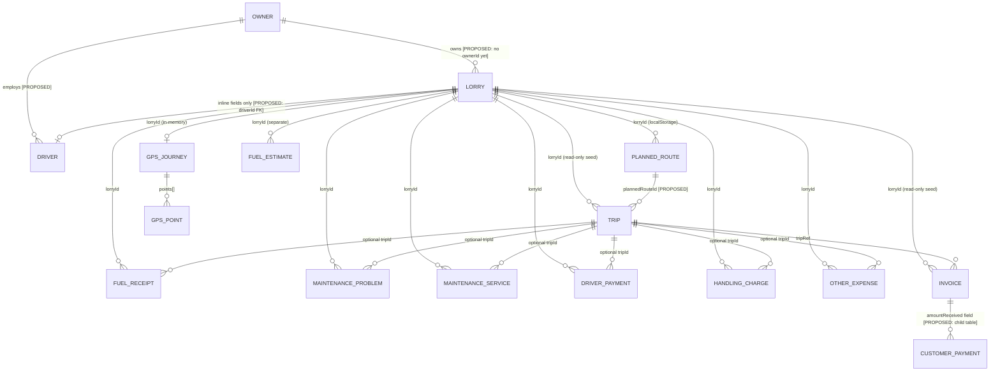
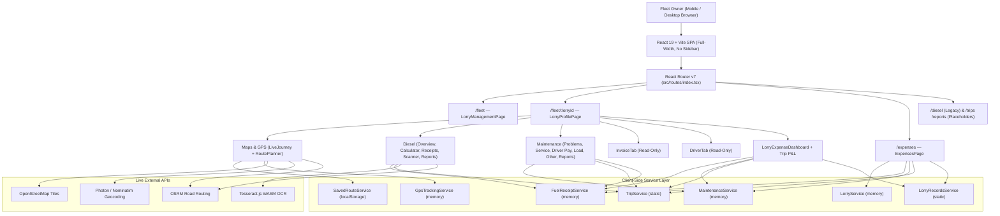
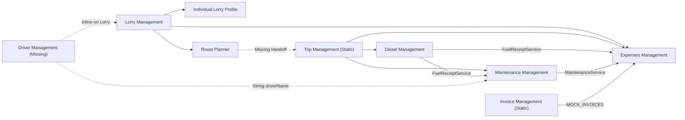
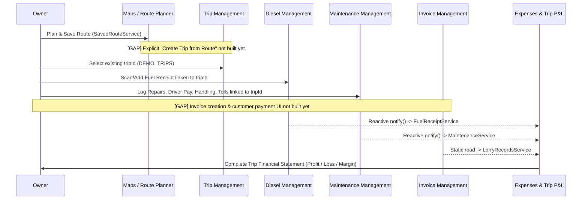
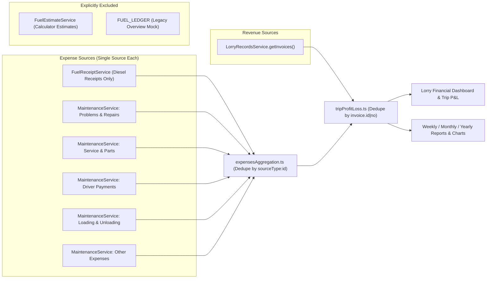
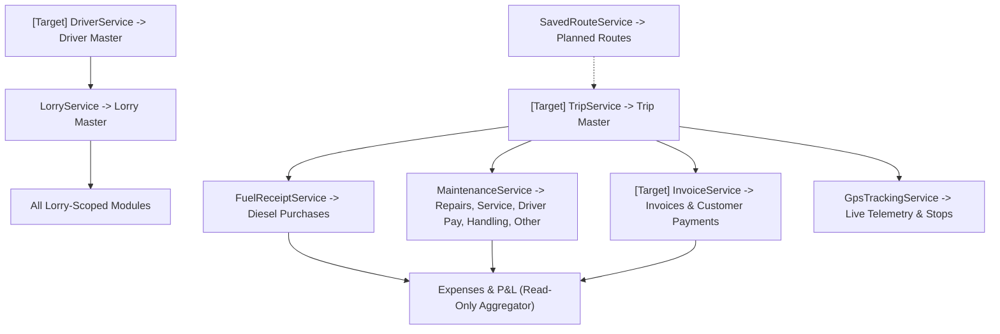

# FleetOS — Complete System Architecture Audit & Module Connection Map

> **Audit Date:** 2026-11-28  
> **Scope:** Read-only inspection of the entire FleetOS repository (`src/` and `public/`). No application code was modified during this audit.  
> **Honesty Standard:** Every claim below was verified directly against source files in the repository. Unimplemented, partial, and mocked connections are explicitly marked.

---

## 1. Complete Project Architecture

### 1.1 Technology Stack & Runtime
- **Frontend Framework:** React 19 (`react@19.0.0`, `react-dom@19.0.0`) + TypeScript 5.7 (`typescript@5.7.3`)
- **Build Tooling:** Vite 6 (`vite@6.1.0`) + Tailwind CSS 3.4 (`tailwindcss@3.4.17`) + `lucide-react` icons
- **Routing:** `react-router-dom@7.1.5` (`createBrowserRouter` with `BASE_URL` basename support for GitHub Pages)
- **Mapping & Routing:** `leaflet@1.9.4` + OpenStreetMap tiles + OSRM public driving router + Photon/Nominatim geocoding
- **Charts:** `recharts@2.15.1`
- **OCR:** `tesseract.js@7.0.0` (in-browser WASM OCR for Smart Fuel Receipt Scanner)
- **PWA Assets:** `public/manifest.webmanifest`, `public/sw.js`, `public/404.html`, `public/icons/icon-{192,512}.png`

### 1.2 Actual Folder Structure
```text
FleetOS/
├── public/
│   ├── 404.html
│   ├── manifest.webmanifest
│   ├── sw.js
│   └── icons/ (icon-192.png, icon-512.png)
└── src/
    ├── App.tsx, main.tsx, vite-env.d.ts
    ├── routes/index.tsx
    ├── styles/index.css
    ├── pages/
    │   ├── common/ModulePlaceholder.tsx
    │   ├── diesel/DieselDashboard.tsx               # Legacy fleet-wide /diesel page
    │   ├── expenses/ExpensesPage.tsx                # /expenses, /expenses/:lorryId, /reports, /trips/:tripId
    │   └── fleet/
    │       ├── LorryManagementPage.tsx              # /fleet (main landing dashboard)
    │       └── LorryProfilePage.tsx                 # /fleet/:lorryId/:section?/:subSection?
    ├── components/
    │   ├── common/ (Badge, Button, Card, Modal, StatCard)
    │   ├── layout/ (Layout, Header — global full-width, no sidebar)
    │   ├── fleet/ (AddLorryModal, DeleteLorryModal, LorryFilterBar, LorrySummaryCards, LorryTable, UnsavedChangesModal)
    │   │   └── profile/ (DriverTab, InvoiceTab, ProfileParts + unused legacy DieselTab, ExpensesTab, MaintenanceTab, MapsGpsTab)
    │   ├── diesel/ (FuelOverviewSection, FuelCalculatorSection, FuelReceiptsSection, FuelReceiptScannerSection, PurchasedDieselReportsSection, LocationSearchInput, RouteMap, + legacy fleet-wide components)
    │   ├── maintenance/ (MaintenanceDashboardSection, ProblemsRepairsSection, ServicePartsSection, DriverPaymentsSection, LoadHandlingSection, OtherExpensesSection, MaintenanceCostReportsSection)
    │   ├── expenses/ (LorryExpenseDashboard, LorryExpenseReports, TripFinancialStatementView)
    │   └── gps/ (LiveJourneyMonitoring, LiveJourneyMap, RoutePlannerSection, RoutePlannerMap)
    ├── services/
    │   ├── lorryService.ts (+ mockLorryData.ts)                 # Reactive in-memory store
    │   ├── fuelReceiptService.ts                                # Reactive in-memory store
    │   ├── fuelEstimateService.ts                               # Reactive in-memory store
    │   ├── maintenanceService.ts                                # Reactive in-memory store
    │   ├── gpsTrackingService.ts                                # Reactive in-memory store
    │   ├── savedRouteService.ts                                 # Reactive store + localStorage persistence
    │   ├── tripService.ts                                       # Static read-only DEMO_TRIPS
    │   ├── lorryRecordsService.ts (+ mockLorryRecords.ts)       # Static read-only MOCK_INVOICES & legacy mocks
    │   ├── mockFuelLedger.ts                                    # Static derived fuel ledger (for FuelOverviewSection)
    │   ├── dieselService.ts (+ mockDieselData.ts)               # Legacy /diesel mock service
    │   └── routingService.ts                                    # Live Photon/Nominatim + OSRM HTTP client
    ├── types/ (common, diesel, fuel, fuelReceipt, gpsTracking, lorry, lorryRecords, maintenance, tripDiesel)
    └── utils/ (calculations, expensesAggregation, formatters, fuelAnalytics, gpsJourneyEngine, maintenanceAnalytics, purchasedDieselAnalytics, receiptOcrParser, tripDieselAnalytics, tripProfitLoss)
```

### 1.3 Application Routing (`src/routes/index.tsx`)
| Route | Page Component | Status |
|---|---|---|
| `/`, `/dashboard`, `*` | Redirects to `/fleet` | Implemented |
| `/fleet` | `LorryManagementPage` (inside `Layout`) | Implemented |
| `/fleet/:lorryId` | `LorryProfilePage` (6-card lorry menu) | Implemented |
| `/fleet/:lorryId/:section/:subSection?` | `LorryProfilePage` (Maps, Invoices, Diesel, Maintenance, Expenses, Driver) | Implemented |
| `/expenses`, `/expenses/:lorryId`, `/expenses/:lorryId/reports`, `/expenses/:lorryId/trips/:tripId` | `ExpensesPage` | Implemented |
| `/diesel` | `DieselDashboardPage` (legacy fleet-wide mock view) | Legacy / Disconnected |
| `/trips`, `/maintenance`, `/reports`, `/settings` | `ModulePlaceholder` | Planned (Placeholder) |

### 1.4 State Management, Persistence & Backend Connectivity
- **State Management:** Lightweight custom pub/sub singleton services (`subscribe(listener)` + `notify()`) consumed via React `useState` + `useEffect` hooks. No Redux/Zustand/React Query.
- **Persistence:**
  - **Persisted (`localStorage`):** ONLY `SavedRouteService` (`fleetos_saved_routes_v1`).
  - **In-memory session only (resets on reload):** `LorryService`, `FuelReceiptService`, `FuelEstimateService`, `MaintenanceService`, `GpsTrackingService`.
  - **Static read-only constants:** `TripService` (`DEMO_TRIPS`), `LorryRecordsService` (`MOCK_INVOICES`, etc.), `FUEL_LEDGER`.
- **External APIs (Live):**
  - OpenStreetMap Tile Server (`tile.openstreetmap.org`)
  - Photon by Komoot (`photon.komoot.io/api`, `/reverse`) with Nominatim fallback (`nominatim.openstreetmap.org`)
  - OSRM Driving Router (`router.project-osrm.org/route/v1/driving`)
  - `tesseract.js` client-side OCR
- **Backend Connectivity:** **None implemented.** No FastAPI server, HTTP client, authentication, or MySQL database exists yet. All services are frontend-only stubs ready to be swapped for REST endpoints.

---

## 2. Module-to-Module Connection Map

| # | Module | Data Owned | Receives From | Provides To | Services & Models Used | Dependent Modules | Connection Status |
|---|---|---|---|---|---|---|---|
| 1 | **Dashboard** (`/fleet`) | Fleet summary KPIs, search/filter state | `LorryService` | Navigation to `LorryProfilePage` | `LorryService`, `Lorry` | Entry point for all lorry views | **Implemented** (lorry list only; no fleet financial KPIs yet) |
| 2 | **Lorry Management** | Lorry master records (`id`, reg no, model, status, inline driver fields) | User CRUD via `AddLorryModal` / `DeleteLorryModal` | `Lorry` object & `lorryId` to all modules | `LorryService`, `Lorry` | All lorry-scoped modules | **Implemented** (no cascading delete) |
| 3 | **Driver Management** | Currently **none** as standalone entity (inline on `Lorry` only) | Reads `lorry.driverName`, mobile, licence from `Lorry` | Read-only display in `DriverTab` | `Lorry` (`DriverTab.tsx`) | Maintenance `DriverPaymentsSection` (pre-fills `driverName` string only) | **Missing** (no `DriverService` or `driverId`) |
| 4 | **Individual Lorry Profile** | Route shell & 6-section navigation | `LorryService.getLorryById(lorryId)` | Passes `lorry` / `lorryId` to child modules | `LorryService`, `FUEL_LEDGER` | All 6 lorry sub-modules | **Implemented** |
| 5 | **Trip Management** | Static `DEMO_TRIPS` (`id`, `lorryId`, route, dates, status) | None (no UI to create/edit trips; `/trips` is placeholder) | `tripId` list to Diesel, Maintenance, Expenses, P&L | `TripService`, `FleetTripRecord` | Diesel Receipts/Reports, Maintenance, Expenses, Trip P&L | **Partially Implemented** (read-only seed; no CRUD UI) |
| 6 | **Maps & Route Planner** | Planned routes (`SavedRouteService`) + GPS telemetry (`GpsTrackingService`) | `LorryService` (lorry selector); live Photon/OSRM APIs | Saved routes & live journey monitoring UI | `SavedRouteService`, `GpsTrackingService`, `routingService`, `gpsJourneyEngine` | None (saved routes not yet linked to Trip creation) | **Implemented standalone** (no Trip creation handoff) |
| 7 | **Diesel Management** | Fuel receipts (`FuelReceiptService`), Fuel estimates (`FuelEstimateService`), static `FUEL_LEDGER` | `LorryService`, `TripService`, `routingService`, `tesseract.js` | Purchased diesel receipts to Maintenance Cost Reports & Expenses/P&L | `FuelReceiptService`, `FuelEstimateService`, `FUEL_LEDGER`, `purchasedDieselAnalytics` | Maintenance Cost Reports, Expenses Management, Trip P&L | **Implemented** (internal split: `FuelOverviewSection` still reads `FUEL_LEDGER` instead of `FuelReceiptService`) |
| 8 | **Maintenance Management** | Problems/Repairs, Service/Parts, Driver Payments, Load Details, Handling Charges, Other Expenses | `LorryService`, `TripService`, `FuelReceiptService` (in Cost Reports) | All 5 expense categories to Expenses Management & Trip P&L | `MaintenanceService`, `maintenanceAnalytics` | Expenses Management, Trip P&L | **Implemented** |
| 9 | **Invoice Management** | Static `MOCK_INVOICES` (freight, additional charges, received, status, `tripRef`) | `LorryRecordsService.getInvoices(lorryId)` | Freight revenue & customer payment status to Trip P&L | `LorryRecordsService`, `LorryInvoice` | Expenses Management & Trip P&L | **Partially Implemented** (read-only; no Create/Edit/Payment UI or pub/sub) |
| 10 | **Expenses Management** | **Read-only aggregator** (owns no primary records) | `LorryService`, `TripService`, `LorryRecordsService`, `FuelReceiptService`, `MaintenanceService` | Lorry Financial Dashboard, Trip-wise P&L Statements, Period P&L Reports & Charts | `expensesAggregation`, `tripProfitLoss` | Fleet Owner Financial Control Centre | **Implemented** (reactive to Diesel & Maintenance; static for Invoices/Trips) |
| 11 | **Reports & Analytics** | Fleet-wide `/reports` is `ModulePlaceholder`; lorry-level reports live inside Diesel, Maintenance & Expenses | N/A at fleet-wide route | N/A at fleet-wide route | `ModulePlaceholder` | None | **Missing** (fleet-wide `/reports` not built) |

---

## 3. Complete Data Flow Audit (Actual Codebase)

### Flow A: Add a lorry → dashboard → lorry profile → all lorry modules
- **Status:** **IMPLEMENTED**
- **Path:** `AddLorryModal.tsx` → `LorryService.createLorry()` (`src/services/lorryService.ts`) assigns monotonic `LR-008` and calls `notify()` → `LorryManagementPage.tsx` updates via `LorryService.subscribe()` → clicking row navigates to `/fleet/LR-008` (`LorryProfilePage.tsx`) → `LorryService.getLorryById('LR-008')` passes `lorry` to all 6 sections (each initializes clean empty states).

### Flow B: Add a driver → assign lorry → create trip
- **Status:** **PARTIALLY IMPLEMENTED / MISSING**
- **Actual Code:** No standalone Driver creation exists. Driver fields (`driverName`, `driverMobile`, `driverLicenceNumber`, `licenceExpiryDate`) are typed inline inside `AddLorryModal.tsx` on the `Lorry` object and read by `DriverTab.tsx`. Creating a trip does **not** exist (`TripService` in `src/services/tripService.ts` is static read-only `DEMO_TRIPS`).

### Flow C: Plan route → save route → explicitly create trip using saved route
- **Status:** **PARTIALLY IMPLEMENTED**
- **Actual Code:** `RoutePlannerSection.tsx` → `fetchRoadRouteAlternatives()` (`routingService.ts`) → `SavedRouteService.saveRoute()` (`savedRouteService.ts`, persists to `localStorage`). **Missing:** No "Create Trip from Saved Route" handoff exists because Trip Management CRUD is not built yet.

### Flow D: Create trip → record diesel purchase → link diesel purchase to trip
- **Status:** **PARTIALLY IMPLEMENTED (Trip creation missing; receipt linking implemented)**
- **Actual Code:** `FuelReceiptScannerSection.tsx` or `FuelReceiptsSection.tsx` → `FuelReceiptService.addReceipt()` (`src/services/fuelReceiptService.ts`) links `tripId` from `TripService.getByLorryId(lorryId)` → immediately reflected in `PurchasedDieselReportsSection.tsx`, `MaintenanceCostReportsSection.tsx`, `LorryExpenseDashboard.tsx`, and `TripFinancialStatementView.tsx`.

### Flow E: Create maintenance record → link to lorry and optionally trip
- **Status:** **IMPLEMENTED**
- **Actual Code:** `ProblemsRepairsSection`, `ServicePartsSection`, `DriverPaymentsSection`, `LoadHandlingSection`, `OtherExpensesSection` → `MaintenanceService.add*()` (`src/services/maintenanceService.ts`) stores `lorryId` + optional `tripId` → calls `notify()` → immediately updates `MaintenanceDashboardSection`, `MaintenanceCostReportsSection`, `LorryExpenseDashboard`, `LorryExpenseReports`, and `TripFinancialStatementView`.

### Flow F: Create invoice → link revenue to trip → record customer payment
- **Status:** **NOT IMPLEMENTED (Read-Only Seed Only)**
- **Actual Code:** `InvoiceTab.tsx` only reads static `MOCK_INVOICES` via `LorryRecordsService.getInvoices(lorryId)`. `tripProfitLoss.ts` reads `amount`, `additionalCharges`, `amountReceived`, and `status` from `MOCK_INVOICES`, but owners cannot yet create invoices or record customer payments in the UI.

### Flow G: Expenses Management → collect diesel & maintenance → calculate trip-wise P&L
- **Status:** **IMPLEMENTED**
- **Actual Code:** `ExpensesPage.tsx` / `LorryExpenseDashboard.tsx` → `getLorryExpenseItems(lorryId)` (`src/utils/expensesAggregation.ts`) collects strictly from `FuelReceiptService` + `MaintenanceService` (deduplicated by `${sourceType}:${id}`) → `buildTripFinancialStatement()` & `buildLorryPeriodFinancialReport()` (`src/utils/tripProfitLoss.ts`) joins with `TripService` + `LorryRecordsService.getInvoices()` to compute Revenue Earned, Cash Received, Expenses Incurred, Expenses Paid, Net Profit/Loss, and Profit Margin.

### Flow H: Edit or delete source record → update all dependent views and reports
- **Status:** **IMPLEMENTED for Diesel Receipts & Maintenance; MISSING for Invoices & Trips**
- **Actual Code:** `FuelReceiptService` and `MaintenanceService` emit `notify()` on every add/update/delete, and `LorryExpenseDashboard`, `LorryExpenseReports`, `ExpensesPage`, and `MaintenanceCostReportsSection` subscribe to both. **Gap:** `LorryProfilePage.tsx`'s `activeExpensesTripStatement` (`useMemo`) does not subscribe to `FuelReceiptService`/`MaintenanceService` directly (it recomputes on navigation), and `LorryRecordsService` (Invoices) has no mutation or `subscribe()` mechanism.

---

## 4. Entity Relationship Diagram

> Solid relationships exist in current code; labels marked `[PROPOSED]` are not yet implemented.



---

## 5. Data Ownership & Source of Truth (Verified vs Target)

| Entity | Target Source of Truth | Actual Current Implementation | Gap / Risk |
|---|---|---|---|
| **Lorry** | Lorry Management (`LorryService`) | `LorryService` (in-memory) | No persistence across reload; no cascading delete |
| **Driver** | Driver Management (`DriverService`) | Inline fields on `Lorry` + free-text `driverName` in `DriverPaymentRecord` | **No `Driver` entity or `driverId`** |
| **Trip** | Trip Management (`TripService`) | Static `DEMO_TRIPS` array | **No CRUD UI or `TripService.createTrip()`** |
| **Planned Route** | Maps & Route Planner (`SavedRouteService`) | `SavedRouteService` (`localStorage`) | No link to Trip Management |
| **GPS Telemetry** | GPS Tracking (`GpsTrackingService`) | `GpsTrackingService` (demo telemetry) | No hardware/provider webhook ingestion |
| **Diesel Purchases** | Diesel Management (`FuelReceiptService`) | **SPLIT across 3 stores:** `FuelReceiptService`, `FUEL_LEDGER`, and `DieselService` | **HIGH RISK:** `FuelOverviewSection` & `/diesel` do not read `FuelReceiptService` |
| **Fuel Estimates** | Diesel Calculator (`FuelEstimateService`) | `FuelEstimateService` (strictly isolated) | Clean — never mixed into expenses |
| **Repairs, Service, Driver Pay, Handling, Other** | Maintenance Management (`MaintenanceService`) | `MaintenanceService` (in-memory) | Clean single source; resets on reload |
| **Freight Invoices & Customer Payments** | Invoice Management (`InvoiceService`) | Static `MOCK_INVOICES` in `LorryRecordsService` | **No Invoice CRUD or CustomerPayment ledger** |
| **Consolidated Expenses & P&L** | Expenses Management (read-only) | `expensesAggregation.ts` + `tripProfitLoss.ts` | Clean read-only rollup; zero duplicate manual entry |

---

## 6. Financial Data Architecture & Duplicate-Counting Risks

### 6.1 Current Financial Calculation Pipeline
- **Freight Revenue (`tripProfitLoss.ts`):** Reads `LorryRecordsService.getInvoices(lorryId)` filtered by `inv.tripRef === trip.id`, deduplicated by `${inv.id}|${inv.invoiceNo}`. `totalRevenue = freightAmount + additionalCharges`.
- **Customer Cash Received vs Pending:** `Paid` invoice → full amount; partial `amountReceived` → capped at invoice total; `Pending`/`Overdue` without `amountReceived` → `₹0` received. Never counts unpaid invoices as cash.
- **Expenses (`expensesAggregation.ts`):** Collects strictly from `FuelReceiptService` + `MaintenanceService` (Problems, Services, Driver Payments, Handling, Other), deduplicated by `${sourceType}:${id}`.
- **Unassigned Expenses:** Items where `tripId` is `undefined` remain unassigned, are excluded from Trip P&L, and are displayed in a separate "Unassigned Lorry Expenses" section on the lorry dashboard.
- **P&L Formulas:** `netProfit = totalRevenue - totalExpenses`; `profitMarginPct = totalRevenue > 0 ? (netProfit / totalRevenue) * 100 : null`; missing revenue marks the trip `INCOMPLETE`.

### 6.2 Identified Duplicate-Counting & Data Integrity Risks
1. **Three Parallel Diesel Stores (`FuelReceiptService`, `FUEL_LEDGER`, `DieselService`):** Although `expensesAggregation.ts` correctly reads ONLY `FuelReceiptService`, `FuelOverviewSection` reads `FUEL_LEDGER` and `/diesel` reads `DieselService`. A user adding a receipt in `FuelReceiptsSection` will see it in Expenses & Purchased Diesel Reports, **but NOT in `FuelOverviewSection`**.
2. **Unused Legacy `MOCK_EXPENSES` & `MOCK_MAINTENANCE` in `mockLorryRecords.ts`:** Still present in the repo; if any future screen imports `LorryRecordsService.getExpenses()`, it would conflict with `MaintenanceService`.
3. **Driver Payment Advances:** `DriverPaymentRecord` tracks `advanceGiven`, `otherDeductions`, `amountPaid`, and `remainingPayable` cleanly, and `settleDriverPayment()` updates in-place (preventing duplicates). However, `expensesAggregation.ts` uses `netAmount = amountPaid + remainingPayable` (which excludes `advanceGiven` already paid earlier unless advances are counted separately — this should be documented clearly as net post-advance payroll cost, or `totalEarnings - otherDeductions` should be used if advances are part of driver cost!).
4. **No Multi-Invoice vs Trip Freight Guard:** When Invoice CRUD is added, Trip Management should store `agreedFreight` as a reference while Invoice Management remains the authoritative source of billed revenue, linked 1:1 or N:1 via `tripId` with a unique invoice number constraint.

---

## 7. ID & Data Isolation Architecture

| Dimension | Current Status | Findings |
|---|---|---|
| **`ownerId` Isolation** | **MISSING** | No `ownerId` field exists on any TypeScript interface or service. `Header.tsx` hardcodes `Syed Aslam`. Must be added to every table/entity before multi-owner production use. |
| **`lorryId` Isolation** | **STRONG** | Every active service (`LorryService`, `FuelReceiptService`, `FuelEstimateService`, `MaintenanceService`, `SavedRouteService`, `GpsTrackingService`, `TripService`, `LorryRecordsService`) filters strictly by `lorryId`. `LR-007` exercises empty states across all modules. |
| **`driverId` Relationship** | **MISSING** | No `driverId` exists; `Lorry` embeds `driverName` and `DriverPaymentRecord` stores `driverName` as a plain string. Renaming a driver breaks payment history linkage. |
| **`tripId` Relationship** | **IMPLEMENTED (Soft FK)** | Optional `tripId` string on Fuel Receipts and all Maintenance records; `tripRef` on Invoices. Unassigned records keep `tripId: undefined`. |
| **Unique ID Generation** | **GOOD (Monotonic in-memory)** | `LorryService`, `FuelReceiptService`, `MaintenanceService`, `SavedRouteService` use monotonic counters (never reusing deleted IDs in-session). *Exception:* `DieselService` uses `Math.random()`. |
| **Referential Integrity & Delete Behaviour** | **MISSING** | `LorryService.deleteLorry(id)` does **not** cascade or block deletion when child records exist, leaving orphaned records in `FuelReceiptService`, `MaintenanceService`, `SavedRouteService`, and `GpsTrackingService`. |
| **Hardcoded / Disconnected Mock Components** | **3 FOUND** | `DieselDashboardPage` (`/diesel` → `DieselService`), `FuelOverviewSection` (`FUEL_LEDGER`), and `InvoiceTab` (`MOCK_INVOICES`). |

---

## 8. Architecture Diagrams

### 8.1 Overall FleetOS System Architecture


### 8.2 Module Dependency Diagram


### 8.3 Trip Lifecycle Data Flow


### 8.4 Expense & Revenue Data Flow


### 8.5 Source-of-Truth Architecture


---

## 9. Current vs Target Architecture

| Layer | CURRENT ARCHITECTURE (In Repo Today) | TARGET ARCHITECTURE (Production Platform) |
|---|---|---|
| **Tenancy & Auth** | Single hardcoded owner (`Syed Aslam`); no login or `ownerId` | JWT/OAuth auth + `ownerId` row-level security (RLS) on every query & table |
| **Persistence** | 1 `localStorage` store (`SavedRouteService`) + 5 in-memory stores + 3 static mocks | FastAPI REST API + MySQL (InnoDB foreign keys, audit timestamps, transactions) |
| **Diesel Data** | Split across `FuelReceiptService`, `FUEL_LEDGER`, and `DieselService` | Single authoritative `FuelReceiptService` feeding Overview, Receipts, Reports & Expenses |
| **Driver Management** | Inline strings on `Lorry`; no `driverId` | First-class `Driver` table + `DriverService` linked by `driverId` to Lorries, Trips & Driver Payments |
| **Trip Management** | Static `DEMO_TRIPS`; `/trips` is a placeholder | Full Trip CRUD + explicit "Create Trip from Saved Route" + Trip lifecycle status |
| **Invoice & Payments** | Static `MOCK_INVOICES` read-only table | Full Invoice CRUD + child `CustomerPayment` receipts table + reactive pub/sub |
| **Referential Integrity** | Orphaned records possible on lorry delete | Soft-delete / archive lorries or DB-enforced foreign key constraints |
| **GPS Hardware** | Demo telemetry points + live OSRM/Photon | Real GPS device webhook/MQTT ingestion into `gps_telemetry_points` + background stop detector |

---

## 10. Recommended Implementation Roadmap (Prioritized — Not Yet Implemented)

1. **Phase 1 — Unify Data Models & Eliminate Legacy Mock Split (Critical):**
   - Add `ownerId` to all core interfaces (`Lorry`, `Trip`, `FuelReceipt`, `Maintenance*`, `Invoice`, `SavedRoute`, `GpsJourney`).
   - Retire `FUEL_LEDGER` and `DieselService` mocks so `FuelOverviewSection` and `/diesel` read directly from `FuelReceiptService`.
   - Remove unused legacy profile tabs (`DieselTab`, `ExpensesTab`, `MaintenanceTab`, `MapsGpsTab`).
   - Add `localStorage` persistence adapter across all reactive services until backend is live.
2. **Phase 2 — First-Class Driver Management (`DriverService`):**
   - Create `Driver` model (`driverId`, `ownerId`, name, mobile, licence, expiry, status) and `DriverService`.
   - Link `Lorry.driverId`, `Trip.driverId`, and `DriverPaymentRecord.driverId`.
3. **Phase 3 — Trip Management & Saved Route Handoff (`TripService` CRUD):**
   - Replace `/trips` placeholder with real Trip Management CRUD.
   - Add explicit **"Create Trip from Saved Route"** action in Route Planner (storing `plannedRouteId` on `Trip`).
4. **Phase 4 — Invoice Management & Customer Payments (`InvoiceService`):**
   - Upgrade `InvoiceTab` to support Create/Edit/Delete Invoice and **Record Customer Payment** (child `CustomerPayment` records) with reactive `subscribe()` so Trip P&L updates live.
5. **Phase 5 — Fleet-Wide Dashboard & `/reports` Integration:**
   - Replace `/reports` placeholder with fleet-wide P&L rollup across all lorries (reusing `buildLorryPeriodFinancialReport`).
   - Add soft-delete / archive guard on `LorryService.deleteLorry()` to prevent orphaned records.
6. **Phase 6 — FastAPI + MySQL Backend & Row-Level Security:**
   - Implement `/api/v1/...` REST endpoints with JWT authentication, `owner_id` scoping on every SQL query, InnoDB FKs, and S3/object storage for receipt/bill images.
7. **Phase 7 — Production GPS Hardware Integration:**
   - Connect real GPS tracker webhooks (Teltonika / Fleetx / Traccar) into `gps_telemetry_points` with server-side stop detection and push alerts.
